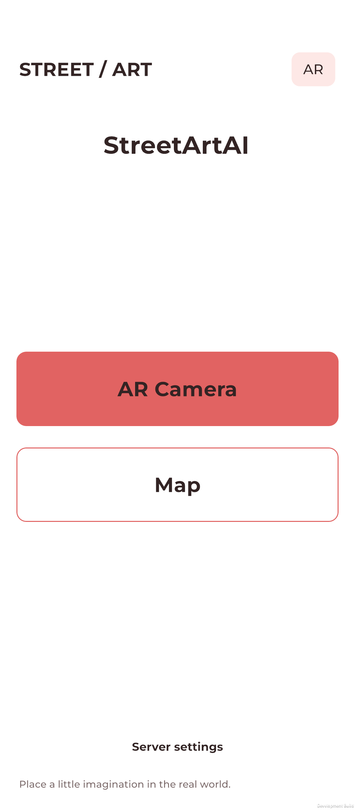
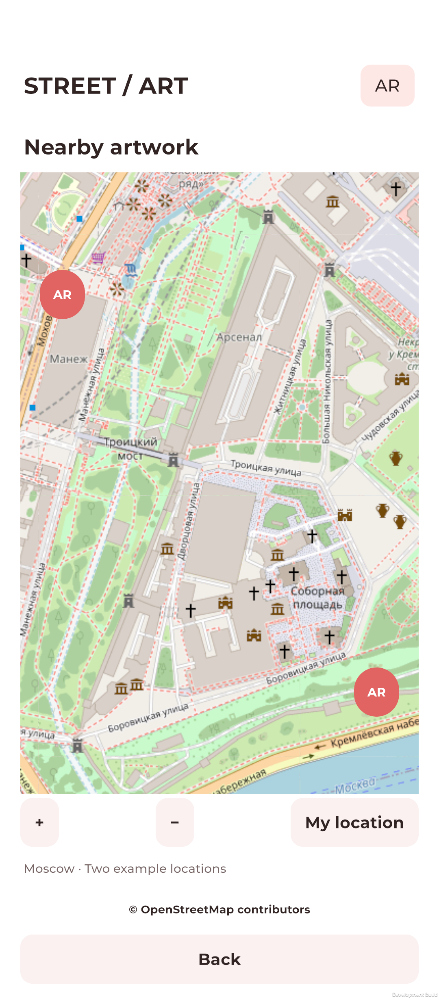
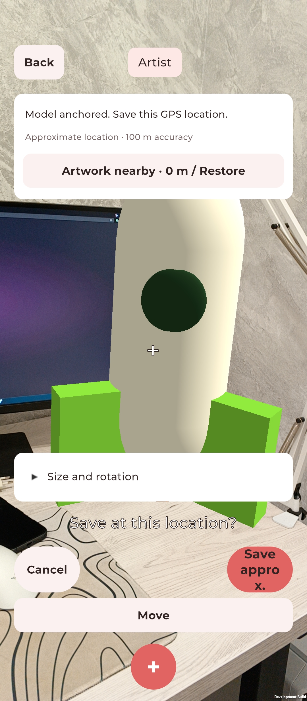
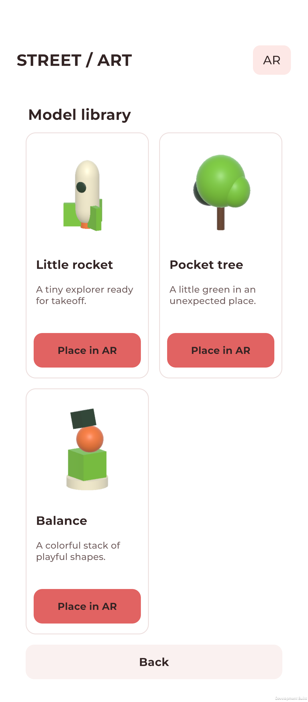

# StreetArtAI · Meshy to Unity AR

Turn a real place into a little work of art. Choose a model, place it with your Android camera and save its location to discover again.

## Features

- **Surface-based AR** with Unity AR Foundation and ARCore, adjustable model size and rotation.
- **Visual model library** with three original models: Little rocket, Pocket tree and Balance.
- **Shared GPS locations** saved to a .NET server with SQLite storage.
- **Nearby artwork on an OpenStreetMap map**, with surface alignment when returning to a saved location.
- **Text-to-3D integration** prepared for Meshy, including preview generation and optional textures. A server-side API key and credits are required.
- **Light portrait interface** with coral accents, Montserrat typography and display cutout support.
- **Android 10+**, targeting Android SDK 37.

Built with Unity 6000.6.5f1 and .NET 10. The library works without a Meshy subscription. GPS locates the area; place the model on a surface again when returning.

[Unity project](Unity/) · [Server setup](Server/README.md)

## Setup

1. Start the backend from the repository root: <code>dotnet run --project Server --urls http://localhost:5052</code>.
2. In the app, open **Server settings**, enter your backend's **HTTPS URL**, then tap **Save** and **Test connection**.
3. Configure the Meshy key **on the server**, before starting it: set the **Meshy__ApiKey** environment variable, or **Meshy:ApiKey** in <code>Server/appsettings.json</code>. Docker Compose reads **MESHY_API_KEY**. Keep real keys out of Git and the Unity client.

Meshy generation needs an API key and available credits. Without a key, the model library, map and saved locations still work. See [Server setup](Server/README.md) for details.

## Screenshots

| Menu | Moscow map |
| :---: | :---: |
|  |  |
| **AR camera** | **Model library** |
|  |  |

## Version 1.0 demos

<table>
  <tr>
    <th align="center">Demo 1</th>
    <th align="center">Demo 2</th>
  </tr>
  <tr>
    <td align="center" width="50%">
       
      <video src="https://github.com/user-attachments/assets/6e496336-529e-4e86-a4b4-60937f1b459c" width="400" controls></video>
    </td>
    <td align="center" width="50%">
       
      <video src="https://github.com/user-attachments/assets/d78bbaad-9680-4bd6-826d-17d915107318" width="400" controls></video>
    </td>
  </tr>
</table>
